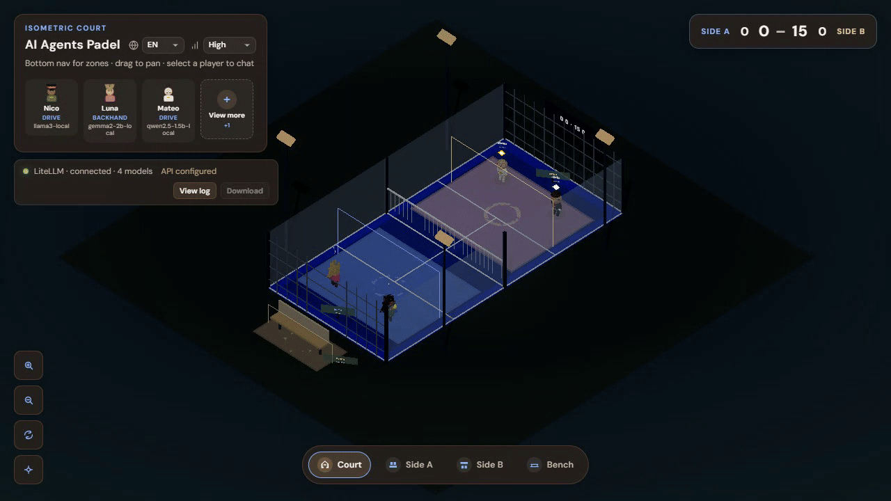

# 🎾 AI Agents Padel Court (WebGL)



Isometric padel court. Four players in two pairs hold their spots and play a stylized rally: the ball arcs between them, there is no physics. Side A wears blue, side B sand. The score is simplified tennis (0, 15, 30, 40, game) on the HUD and on a sign at the far end. Click a player to chat; the rally pauses while the panel is open. Between points, partners talk to each other.

Night court: blue turf, white lines, glass sides, mesh back walls, a net, four floodlights, and a bench outside the near side. Camera shots: full court, side A, side B, bench.

## 🦙 Run it on local LiteLLM (no API cost)

Models stay on your machine through [LiteLLM.Local](https://github.com/agustinafassina/LiteLLM.Local) and Ollama. No cloud key.

1. Start Ollama and LiteLLM.Local (`docker compose up -d` in that repo). The proxy listens on `http://localhost:4000`.
2. In this repo, copy `.env.example` to `.env` and set the same `master_key` as `LiteLLM.Local/config.yaml`:

```env
VITE_USE_MOCK_LITELLM=false
VITE_LITELLM_BASE_URL=/api/litellm
VITE_LITELLM_API_KEY=replace_with_your_key
LITELLM_PROXY_TARGET=http://localhost:4000
```

Leave `VITE_LITELLM_BASE_URL` as `/api/litellm`. The browser must not call `:4000` directly.

3. Install and start:

```bash
npm install
npm run dev
```

Open `http://localhost:5174`. Restart `npm run dev` after any `.env` change.

The four `modelId` values in `public/agents.json` match LiteLLM.Local: `llama3-local`, `gemma2-2b-local`, `qwen2.5-1.5b-local`, `llama3.2-1b-local`. If the HUD marks a model unavailable, the key was rejected or that name is missing from `/v1/models`.
