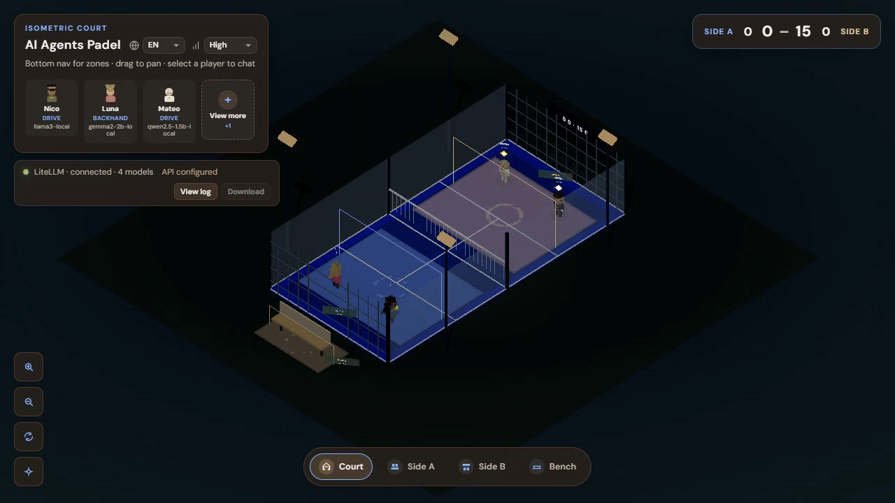

# 🎾 AI Agents Padel Court (WebGL)



Isometric padel court. Four players in two pairs hold their spots and play a stylized rally: the ball arcs between them, there is no physics. Side A wears blue, side B sand. The score is simplified tennis (0, 15, 30, 40, game) on the HUD and on a sign at the far end. Click a player to chat; the rally pauses while the panel is open. Between points, partners talk to each other.

Night court: blue turf, white lines, glass sides, mesh back walls, a net, four floodlights, and a bench outside the near side. Camera shots: full court, side A, side B, bench.

## ⚡ Quick start (mock models)
No LLM needed. The default `.env.example` uses built-in mock models.

```bash
cp .env.example .env
npm install
npm run dev
```

Open `http://localhost:5174`.

## 🎮 Controls
| Action | How |
| --- | --- |
| Chat with a player | Click the player or their card in the HUD |
| Pan the camera | Drag the background, right-drag, or Shift + drag |
| Zoom | Mouse wheel or the zoom buttons |
| Switch camera shot | Bottom navigation (full court, side A, side B, bench) |
| Follow a player | Select a player, then the Follow button on screen |
| Agent log | "View log" in the HUD to read, clear, or download between-point chats |
| Language / quality | EN · ES toggle and High / Medium / Low graphics in the HUD |

Add `?demo=1` to the URL for faster peer chats (used to record the GIF).

## 🦙 Run it on local LiteLLM (no API cost)
Models stay on your machine through [LiteLLM.Local](https://github.com/agustinafassina/LiteLLM.Local) and Ollama. No cloud key.

1. Start Ollama and LiteLLM.Local (`docker compose up -d` in that repo). The proxy listens on `http://localhost:4000`.
2. In this repo, copy `.env.example` to `.env` and set the same `master_key` as `LiteLLM.Local/config.yaml`:

```env
VITE_USE_MOCK_LITELLM=false
VITE_LITELLM_BASE_URL=/api/litellm
VITE_LITELLM_API_KEY=replace_with_your_key
LITELLM_PROXY_TARGET=http://localhost:4000
```

Leave `VITE_LITELLM_BASE_URL` as `/api/litellm`. The browser must not call `:4000` directly.

3. Install and start:

```bash
npm install
npm run dev
```

Open `http://localhost:5174`. Restart `npm run dev` after any `.env` change.

The four `modelId` values in `public/agents.json` match LiteLLM.Local: `llama3-local`, `gemma2-2b-local`, `qwen2.5-1.5b-local`, `llama3.2-1b-local`. If the HUD marks a model unavailable, the key was rejected or that name is missing from `/v1/models`.

## 🐳 Docker

The image builds the app and serves it with nginx, which also proxies `/api/litellm` to LiteLLM.

```bash
cp .env.example .env   # edit as above
docker compose up --build
```

Open `http://localhost:3001` (change with `PADDLE_MAP_PORT`). nginx forwards to `LITELLM_UPSTREAM`, `http://host.docker.internal:4000` by default. `VITE_*` values are baked in at build time, so rebuild after changing them.

## ⚙️ Configuration

| Variable | Default | Purpose |
| --- | --- | --- |
| `VITE_USE_MOCK_LITELLM` | `true` | `true` uses mock models, `false` calls LiteLLM |
| `VITE_LITELLM_BASE_URL` | `/api/litellm` | Same-origin proxy path |
| `VITE_LITELLM_API_KEY` | empty | Bearer token for LiteLLM |
| `VITE_ENABLE_AGENT_PEER_CHAT` | `true` | Partners chat with each other between points |
| `VITE_AGENTS_CONFIG_URL` | `/agents.json` | Where the player roster is loaded from |
| `LITELLM_PROXY_TARGET` | `http://localhost:4000` | Dev only: Vite proxy upstream |
| `LITELLM_UPSTREAM` | `http://host.docker.internal:4000` | Docker only: nginx upstream |
| `PADDLE_MAP_PORT` | `3001` | Docker only: host port |

> ⚠️ `VITE_*` values end up in the browser bundle, including the API key. Use this for local or trusted deployments only.

### Players
Edit [`public/agents.json`](public/agents.json) to change the roster. Each player has:

```json
{
  "id": "nico-agent",
  "name": "Nico",
  "role": { "en": "Drive", "es": "Derecha" },
  "modelId": "llama3-local",
  "homeZone": "side-a",
  "avatarColor": "#3d7eea",
  "accentColor": "#1d4ed8",
  "logoUrl": "/logos/ops.svg",
  "avatarDesignId": "...",
  "systemPrompt": { "en": "...", "es": "..." }
}
```

`role` and `systemPrompt` take one string per language. `modelId` must match a model your LiteLLM proxy exposes.

## 🧱 Stack

React 19, [React Three Fiber](https://r3f.docs.pmnd.rs/) + drei + postprocessing, Three.js, Zustand, Vite, TypeScript.

```text
src/
  components/scene/   3D court, camera, lighting, avatars
  components/ui/      HUD, chat panel, navigation, agent log
  config/             env, court layout, zones, agent loading
  services/           LiteLLM client and agent orchestrator
  stores/             Zustand state (match, chat, scene, graphics…)
  i18n/               EN / ES strings
  utils/              movement, collision, textures, storage
```

## 🛠️ Scripts
| Command | What it does |
| --- | --- |
| `npm run dev` | Dev server on `:5174` |
| `npm run build` | Typecheck and production build to `dist/` |
| `npm run preview` | Serve the production build |
| `npm run lint` | ESLint |
